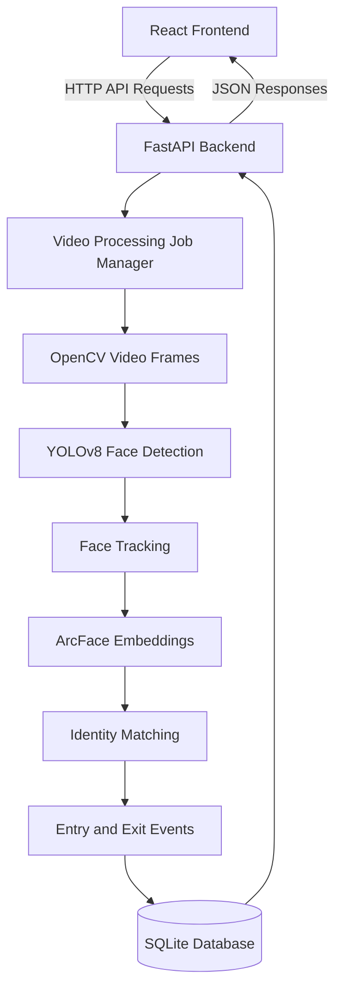

# Intelligent Face Tracker with Auto-Registration and Visitor Counting

An AI-powered application that detects faces in videos, tracks visitors, recognizes previously registered identities, and records entry and exit events.

## Features

- Face detection using YOLOv8-Face
- Face recognition using ArcFace embeddings
- Visitor tracking across video frames
- Automatic registration of new identities
- Entry and exit event logging
- Interactive analytics dashboard
- REST API using FastAPI
- SQLite database for visitor records

## Tech Stack

- **Frontend:** React, TypeScript, Vite
- **Backend:** Python, FastAPI
- **AI & Computer Vision:** YOLOv8-Face, ArcFace, OpenCV
- **Database:** SQLite with WAL mode
- **Testing:** pytest

## Setup Instructions

### 1. Clone the repository

```bash
git clone https://github.com/kamalesh200616/intelligent-face-tracker1.git
cd intelligent-face-tracker1
```

### 2. Set up the Python backend

```bash
python -m venv venv
```

Activate the environment on Windows:

```powershell
.\venv\Scripts\Activate.ps1
```

Install dependencies:

```bash
pip install -r requirements.txt
```

### 3. Download AI models

```bash
python scripts/download_models.py --model all
```

### 4. Start the backend

```bash
python server.py
```

The backend runs at `http://127.0.0.1:8000`.

### 5. Start the frontend

Open another terminal:

```bash
cd frontend
npm install
npm run dev
```

Open the local URL displayed by Vite in your browser.

## Assumptions

- Input videos contain visible faces with sufficient lighting and image quality.
- Pretrained models are available in the expected `models/` directory.
- Face recognition depends on image quality and the configured similarity threshold.
- A returning visitor may receive a new temporary tracking ID but retain the same registered identity.
- Visitor entry and exit events depend on the tracking and event-management logic.

## Sample `config.json`

The following is an illustrative configuration structure. Adjust the keys to match the application's actual configuration implementation.

```json
{
  "detection": {
    "confidence_threshold": 0.60,
    "frame_skip": 2,
    "minimum_face_size": 40
  },
  "recognition": {
    "similarity_threshold": 0.60
  },
  "tracking": {
    "iou_threshold": 0.35,
    "minimum_hits": 3,
    "timeout_seconds": 2
  },
  "database": {
    "path": "data/visitor_tracker.db"
  }
}
```

## AI Planning

1. **Video input:** Read frames from an uploaded video or supported camera source.
2. **Face detection:** Use YOLOv8-Face to detect faces and bounding boxes.
3. **Face tracking:** Associate detections across frames using tracking IDs.
4. **Face recognition:** Generate 512-dimensional face embeddings using ArcFace.
5. **Identity matching:** Compare embeddings using cosine similarity and reuse a matching identity or register a new one.
6. **Event management:** Record confirmed entry and exit events.
7. **Data storage:** Store identities, events, and session information in SQLite.
8. **Dashboard:** Retrieve statistics and processing status through backend APIs.

## Application Architecture



## Video Demonstration

[Watch the project explanation and demonstration on YouTube](https://youtu.be/jvix8LB4dSA)

## GitHub Repository

[View the source code](https://github.com/kamalesh200616/intelligent-face-tracker1)

---

This project is a part of a hackathon run by https://katomaran.com
